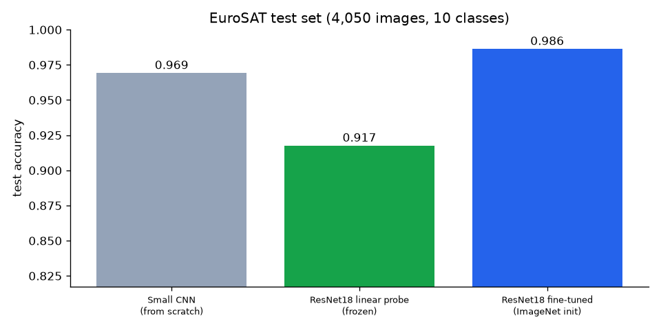
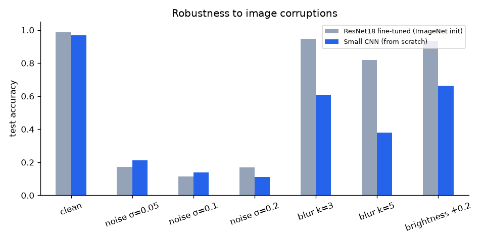
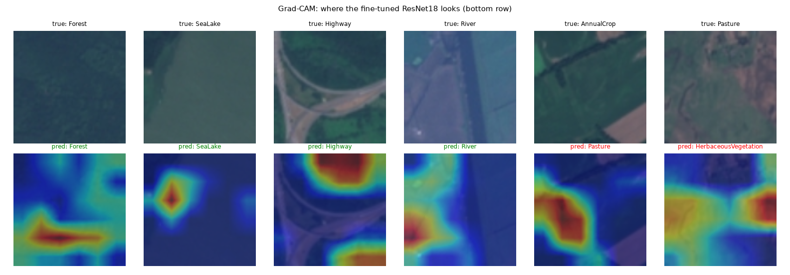
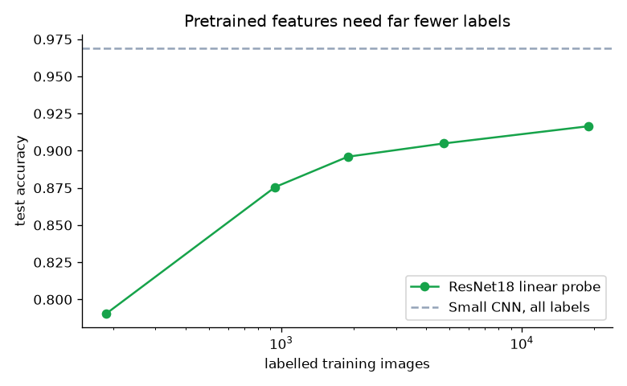
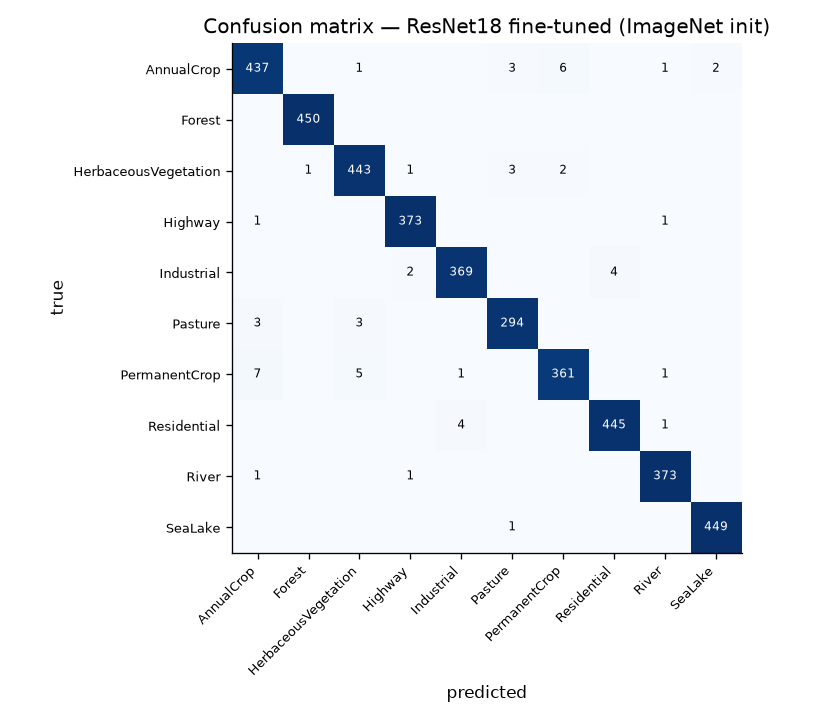

# Satellite Land-Use Classification — Transfer Learning, Grad-CAM & Robustness


Classifying **27,000 Sentinel-2 satellite images** (EuroSAT, 10 land-use classes) to compare three ways of
building an image classifier — and to check *what the model looks at* and *how it breaks*.

| Approach | Idea |
|---|---|
| Small CNN from scratch | 0.6M-parameter 4-block CNN, trained only on EuroSAT |
| ResNet18 linear probe | Frozen ImageNet features + logistic regression (only 5K trainable parameters) |
| ResNet18 fine-tuned | All layers fine-tuned from ImageNet weights |

## Results (held-out test set, 4,050 images)

| Model | Test accuracy | Macro-F1 | Trainable params | Train time (CPU) |
|---|---|---|---|---|
| Small CNN (from scratch) | 96.9% | 0.969 | 0.6M | 49 min (15 epochs) |
| ResNet18 linear probe (frozen) | 91.8% | 0.914 | **5K** | **2 min** |
| **ResNet18 fine-tuned (ImageNet init)** | **98.6%** | **0.986** | 11.2M | 19 min (5 epochs) |



### Key findings
1. **Fine-tuning a pretrained network wins — and trains faster.** 98.6% accuracy in 5 epochs, vs 96.9% for a
   CNN trained from scratch for 15 epochs (2.6× longer). Pretraining gives a better *and* cheaper starting point.
2. **Frozen ImageNet features transfer only partly to satellite imagery.** The linear probe tops out at 91.8%:
   overhead imagery looks very different from ImageNet photos, so the features need adapting, not just re-reading.
   It is still remarkably label-efficient — **79% accuracy from just 187 labelled images** (1% of the data).
3. **The models are brittle to sensor noise — the most important production finding.** Accuracy collapses from
   ~98% to ~17% with even mild Gaussian noise (σ = 0.05). The likely cause: EuroSAT tiles are fairly low-contrast and
   neither model saw noise during training, so small per-pixel noise swamps the fine textures they rely on. Pretraining helps with blur and brightness shifts
   (fine-tuned ResNet keeps 82–95% vs 38–66% for the scratch CNN) but **not** with noise.
   The fix — noise augmentation in training — is the clear next step before deployment.
4. **Remaining errors are agronomically plausible:** the most common confusion is *PermanentCrop → AnnualCrop*,
   two classes that look alike from orbit.



| Corruption | Small CNN | Fine-tuned ResNet18 |
|---|---|---|
| clean | 96.9% | 98.6% |
| blur (k=3) | 60.9% | **94.6%** |
| blur (k=5) | 38.1% | **81.8%** |
| brightness +0.2 | 66.2% | **93.4%** |
| Gaussian noise σ=0.05 | 21.3% | 17.1% |

### What does the model look at? (Grad-CAM)
Bottom row: Grad-CAM heat-maps on the fine-tuned ResNet18 (red = most influential region). For *Highway* the
model concentrates on the road junction. The two red-titled examples are mistakes; in both, the model attends
to a patch of uniform vegetation and confuses neighbouring vegetation classes (AnnualCrop → Pasture,
Pasture → HerbaceousVegetation).






## How it works
- All 27,000 images decoded once into a cached `uint8` tensor; **batched tensor augmentation**
  (flips, 90° rotations — satellite tiles have no "up") instead of slow per-image PIL transforms.
- Stratified 70/15/15 split; best epoch chosen on validation; one-cycle LR schedule, AdamW, label smoothing.
- **Grad-CAM** implemented from scratch with forward/backward hooks ([`models.py`](src/visionkit/models.py)).
- Corruption suite: Gaussian noise, Gaussian blur, brightness shift.
- Tests run on synthetic images with random weights — no downloads in CI.

## Run it
```bash
pip install torch torchvision --index-url https://download.pytorch.org/whl/cpu
pip install -r requirements-dev.txt && pip install -e .
pytest -q                                  # 13 offline tests
python -m visionkit.experiment --smoke     # whole pipeline on synthetic data in seconds
python -m visionkit.experiment             # full benchmark (~1.2 h on CPU, minutes on GPU)
```

## Data
[EuroSAT](https://github.com/phelber/eurosat) (Helber et al., 2019) — RGB Sentinel-2 tiles, 64×64 px, 10 classes.
